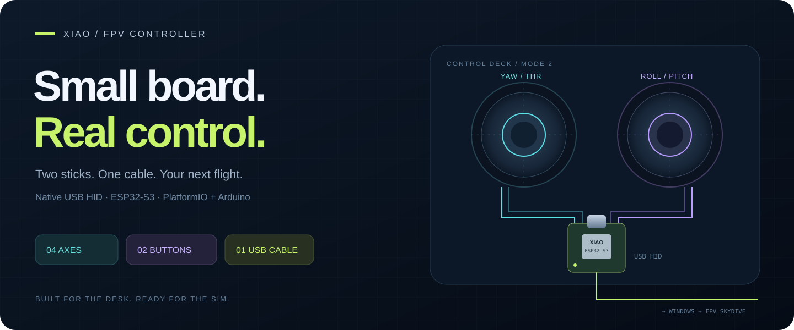
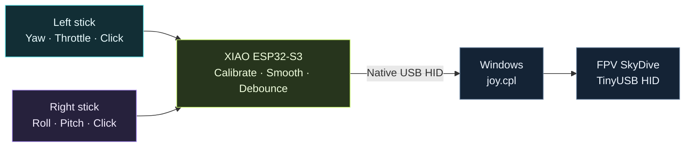
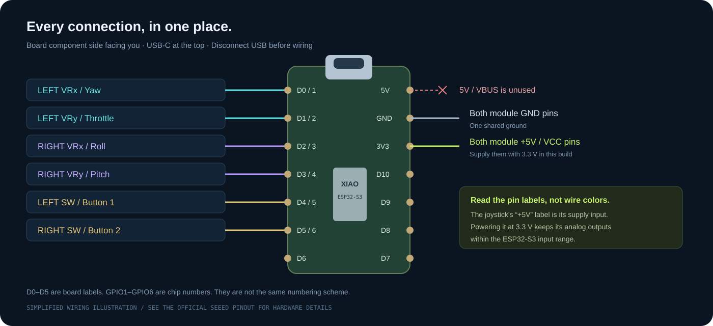

<p align="center">
  
</p>

<h1 align="center">XIAO FPV Controller</h1>
<p align="center"><strong>Two sticks. One cable. Your next simulated flight.</strong></p>

<p align="center">
  <a href="https://github.com/Am4l-babu/xiao-fpv-controller/actions/workflows/build.yml"></a>
  
  
  
</p>

<p align="center">
  <a href="#meet-the-controller">Explore</a> &middot; <a href="#wire-it">Wiring</a> &middot;
  <a href="#build-and-flash">Build &amp; flash</a> &middot; <a href="#make-it-yours">Calibration</a> &middot;
  <a href="#take-it-into-skydive">SkyDive</a> &middot; <a href="#troubleshooting">Troubleshooting</a>
</p>

---

Turn two inexpensive analog joystick modules into a **native USB game controller** with a Seeed Studio XIAO ESP32-S3. Plug it into Windows, check it in `joy.cpl`, and map the controls in FPV SkyDive.

The firmware reads **four independent axes**, debounces **two stick-click buttons**, and sends them together in one HID report. A separate test build sweeps the axes before the joysticks are wired.

> **Tested on real hardware:** native USB upload, four-axis travel, calibrated neutral, and Windows button response. SkyDive detects the controller. In-game flight and action bindings still need their own calibration. [What was actually verified →](docs/TESTED.md)

## Meet the controller

| Left hand | Right hand | Inside the board |
| :--- | :--- | :--- |
| ↔ **Yaw** · ↕ **Throttle** | ↔ **Roll** · ↕ **Pitch** | Four 12-bit ADC inputs |
| Click → **Button 1** | Click → **Button 2** | 20 ms switch debounce |
| USB **X / Y** | USB **Z / Z rotation** | 8 ms report schedule |



<details>
<summary><strong>What you need on the desk</strong></summary>

| Part | Quantity | Notes |
| --- | ---: | --- |
| [Seeed Studio XIAO ESP32-S3](https://wiki.seeedstudio.com/xiao_esp32s3_getting_started/) | 1 | Native USB-C connection |
| [PS2-style analog joystick module](https://robocraze.com/products/joystick-module) | 2 | VRx, VRy and a push switch |
| USB data cable | 1 | A charging-only cable cannot enumerate HID |
| Jumper wires and suitable headers | As needed | Both modules share power and ground |
| Windows + VS Code + PlatformIO IDE | — | Reference development setup |
| FPV SkyDive through Steam | — | Reference game: 2.9.2(b) |

</details>

## Wire it

**Unplug USB before wiring. Power both joystick modules from 3V3.**

<p align="center"></p>

<details open>
<summary><strong>Open the connection table</strong></summary>

| Module pin | XIAO label | Chip GPIO | USB control |
| --- | --- | ---: | --- |
| Left **VRx** | **D0 / A0** | 1 | X → yaw |
| Left **VRy** | **D1 / A1** | 2 | Y → throttle |
| Right **VRx** | **D2 / A2** | 3 | Z → roll |
| Right **VRy** | **D3 / A3** | 4 | Z rotation → pitch |
| Left **SW** | **D4** | 5 | Button 1 |
| Right **SW** | **D5** | 6 | Button 2 |
| Both **VCC / +5V** pins | **3V3** | — | Module supply at 3.3 V |
| Both **GND** pins | **GND** | — | Common ground |

**About that "+5V" label:** the reference joystick uses passive potentiometers. Feed its supply pin from **3V3** so its analog outputs stay within the ESP32-S3 input range. The seller lists 5 V operation; using 3.3 V here follows the passive divider design. Do not feed 5 V analog signals directly into the XIAO.

With the component side facing you and USB-C at the top, **D0?D5 run down the left edge**. The top three right-edge pads are **5V, GND, 3V3**. Check the [official pinout](https://files.seeedstudio.com/wiki/SeeedStudio-XIAO-ESP32S3/img/XIAO_ESP32-S3_front_pinout.png) if viewing the underside.

</details>

<details>
<summary><strong>How the two buttons behave</strong></summary>

SW closes to GND when the stick is pressed. Internal pull-ups keep unwired or released switches inactive. After 20 ms of stable input, the USB button is pressed or released. Both buttons can be held together.

They are **momentary buttons**. The firmware does not assign game actions, latch arm state, or emulate keyboard keys.

</details>

## Build and flash

Open this folder in VS Code, enable **PlatformIO IDE**, and select **PlatformIO: New Terminal** from the Command Palette.

```powershell
# Build the normal, physical joystick firmware.
pio run -e xiao_joystick

# Identify YOUR XIAO by unplugging and reconnecting it.
pio device list

# Replace COMx with its current, positively identified port.
pio run -e xiao_joystick -t upload --upload-port COMx
```

**Prefer a button?** PlatformIO alien icon → **PROJECT TASKS → xiao_joystick → General → Upload**. Or select `xiao_joystick` and click the bottom **right-arrow Upload** button.

<details>
<summary><strong>PlatformIO is installed, but "pio" is not found</strong></summary>

Use PlatformIO's own terminal, or its full Windows path:

```powershell
& "$env:USERPROFILE\.platformio\penv\Scripts\platformio.exe" device list
& "$env:USERPROFILE\.platformio\penv\Scripts\platformio.exe" run -e xiao_joystick -t upload --upload-port COMx
```

Close Serial Monitor before uploading. A 1200-baud reset and new-port detection handle the transition between application and bootloader COM ports.

</details>

<details>
<summary><strong>Test USB before wiring the sticks</strong></summary>

```powershell
pio run -e xiao_axis_test -t upload --upload-port COMx
```

Open `joy.cpl` → **XIAO_FPV_Joystick → Properties → Test**. Watch for **16 seconds**: X, Y, Z and Z rotation each get a four-second slot, moving center → positive → negative → center. The other axes stay centered. Buttons still follow the physical switches.

**Restore the normal build before calibration or flight:**

```powershell
pio device list
pio run -e xiao_joystick -t upload --upload-port COMx
```

Selecting a different environment in VS Code does not change firmware already flashed to the board.

</details>

<details>
<summary><strong>Inspect the pinned toolchain and USB settings</strong></summary>

| Setting | Value |
| --- | --- |
| Platform | `platformio/espressif32@7.0.1` |
| Board ID | `seeed_xiao_esp32s3` |
| Framework | Arduino-ESP32 **2.0.17** |
| Arduino package | `3.20017.241212` |
| Uploader | esptool **4.11.0** / package `2.41100.0` |
| USB mode | `ARDUINO_USB_MODE=0` → USB-OTG / TinyUSB |
| USB serial | `ARDUINO_USB_CDC_ON_BOOT=1` |
| HID library | Espressif's built-in `USBHIDGamepad` |

The board manifest defaults to hardware USB Serial/JTAG mode `1`. This project removes that flag and selects mode `0` for HID. The SDK already includes TinyUSB HID support.

The official descriptor advertises six signed 8-bit axes, 32 buttons and a hat. This project actively uses **four axes and two buttons**; the other controls stay neutral. It is generic USB HID, not Xbox/XInput.

</details>

## Make it yours

Open **Win+R → `joy.cpl` → XIAO_FPV_Joystick → Properties → Test**. Move one direction at a time, then click each stick. Axes should move independently, and Buttons **1 / 2** should light only while pressed.

The `axes[]` table in [src/main.cpp](src/main.cpp) keeps calibration in one place:

```cpp
// pin, minimum, center, maximum, deadzone, inverted
{D0, 0, 1857, 4095, 40, false},  // yaw
{D1, 0, 1884, 4095,  0, false},  // throttle
{D2, 0, 1914, 4095, 40, false},  // roll
{D3, 0, 1905, 4095, 40, false},  // pitch
```

These centers were measured on the reference build. **Measure your own modules.** Set an axis's final field to `true` to reverse its direction, then rebuild and upload.

> **Throttle deserves attention.** A spring-centered stick rests near half throttle when using full travel. Move it to the low endpoint when arming; the center is not zero throttle.

<details>
<summary><strong>Record a calibration session</strong></summary>

Serial Monitor prints a compact line every 500 ms while the host is ready:

```text
J RAW=1857,1884,1914,1905 HID=0,0,0,0 BTN=0
```

Order: **yaw, throttle, roll, pitch**. `BTN`: `0` released, `1` left, `2` right, `3` both. `T` identifies the automatic test build.

```powershell
pio device monitor -p COMx -b 115200
```

Or install the helper dependency and save real measurements:

```powershell
python -m pip install -r requirements.txt

# Leave both sticks released.
python tools/capture_calibration.py --phase centers --seconds 6 --output logs/centers.json

# Slowly visit all travel limits.
python tools/capture_calibration.py --phase travel --seconds 30 --output logs/travel.json
```

The helper selects one matching XIAO application port. Use `--port COMx` or `--serial YOUR_USB_SERIAL` if several boards are connected. It records values; it does not edit or upload firmware.

</details>

<details>
<summary><strong>Run the optional Windows USB checks</strong></summary>

The probe reads real joystick values through WinMM. Disconnect other controllers so selection is unambiguous.

```powershell
# Automatic sweep firmware only.
python tools/windows_probe.py --test --seconds 17

# Press/release left, right, then both; finish released.
python tools/windows_probe.py --buttons --seconds 20
```

The shell needs permission to read the Windows joystick device. These checks do not inject game input.

</details>

## Take it into SkyDive

1. Connect the controller before launching the game.
2. Open **Settings → Controls → Choose Input → TinyUSB HID**.
3. Select **Input Calibration → Configure** and follow the full-travel prompts.
4. Map **left yaw/throttle** and **right roll/pitch**. Check directions and channel bars.
5. If the game accepts button bindings, try **Button 1 → Arm/Disarm**, **Button 2 → Reset**. Confirm them in game.

Windows calls it **XIAO_FPV_Joystick**; SkyDive 2.9.2(b) was observed calling it **TinyUSB HID**. Menu names can vary by version. A green controller icon confirms detection, not a completed channel map.

## Troubleshooting

<details>
<summary><strong>Upload fails, or the COM port disappears</strong></summary>

1. Close Serial Monitor and try a known USB data cable.
2. Unplug USB. Hold **BOOT**, reconnect USB, then release BOOT.
3. Run `pio device list` and use the new bootloader port.
4. Retry uploading. Press **RESET** with BOOT released if the application stays in boot mode.

The ROM may identify as Espressif `303A:1001`; the application uses Seeed `2886:0056`. The ROM ID alone does not prove the board model. Identify the board before flashing.

</details>

<details>
<summary><strong>Windows works, but SkyDive ignores it</strong></summary>

Reselect **TinyUSB HID** under Controls. Disconnect other controllers and check the active input profile.

If needed, exit the game and open **Steam Library → right-click FPV SkyDive → Properties → Controller → Disable Steam Input**. Relaunch, select the device and repeat calibration. Use keyboard bindings if the game does not accept button assignment.

</details>

<details>
<summary><strong>Axes drift, run backwards, or move without wiring</strong></summary>

- Measure released centers and endpoints, then update `axes[]`.
- Flip `inverted` for a reversed axis. Swap VRx/VRy wires if the module is mounted differently.
- Unwired ADC inputs float; random motion is not a successful wiring check.
- Extra centered axes and unused button indicators come from the official descriptor.
- Restore `xiao_joystick` if automatic motion keeps repeating.

</details>

## Inside the repository

```text
|-- platformio.ini              pinned board, framework and build modes
|-- src/main.cpp                four axes + two debounced USB buttons
|-- tools/
|   |-- capture_calibration.py  record raw ADC and HID values
|   `-- windows_probe.py        inspect axes and buttons through WinMM
|-- docs/
|   |-- assets/                 original README illustrations
|   |-- SETUP.md                detailed wiring and recovery guide
|   `-- TESTED.md               hardware verification and its limits
`-- .github/workflows/build.yml compile both firmware modes in CI
```

Local raw captures, USB serial identifiers, build caches and workstation configuration stay outside Git. CI compiles the firmware; it does not test physical hardware or the simulator.

## Official references

- [Seeed pinout, power and BOOT instructions](https://wiki.seeedstudio.com/xiao_esp32s3_getting_started/)
- [PlatformIO board documentation](https://docs.platformio.org/en/stable/boards/espressif32/seeed_xiao_esp32s3.html) · [versioned board manifest](https://github.com/platformio/platform-espressif32/blob/v7.0.1/boards/seeed_xiao_esp32s3.json)
- [Platform 7.0.1 / Arduino 2.0.17 release](https://github.com/platformio/platform-espressif32/releases/tag/v7.0.1)
- [Espressif Gamepad example](https://github.com/espressif/arduino-esp32/blob/2.0.17/libraries/USB/examples/Gamepad/Gamepad.ino) · [matching HID API](https://github.com/espressif/arduino-esp32/blob/2.0.17/libraries/USB/src/USBHIDGamepad.h)
- [Orqa calibration instructions](https://orqafpv.freshdesk.com/support/solutions/articles/48001249756-calibration)

<p align="center"><sub>Small hardware. Clear wiring. Repeatable checks.</sub><br><a href="#xiao-fpv-controller">Back to the top ↑</a></p>
